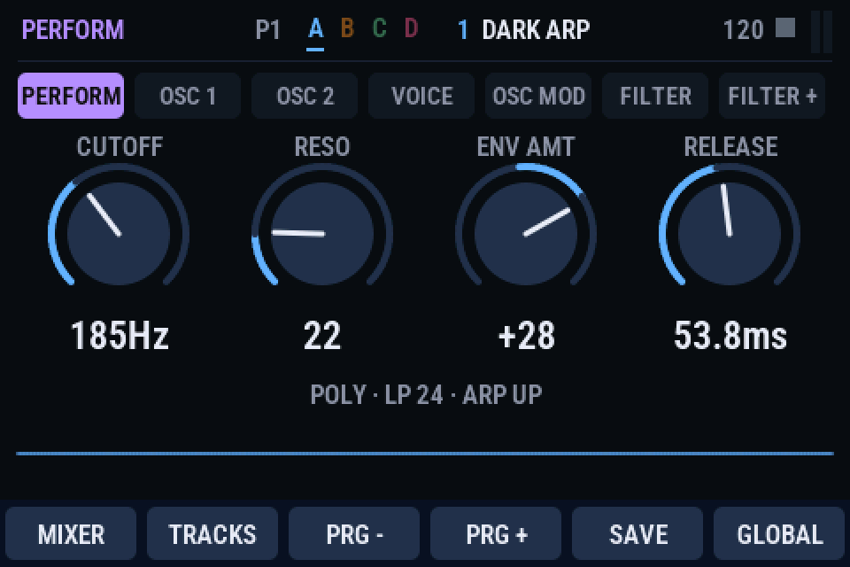
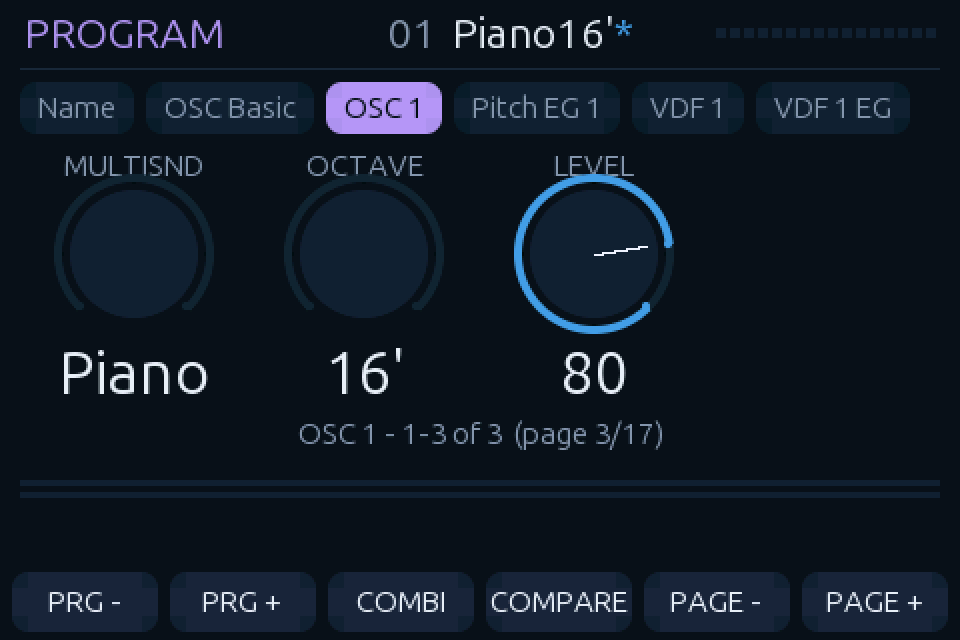
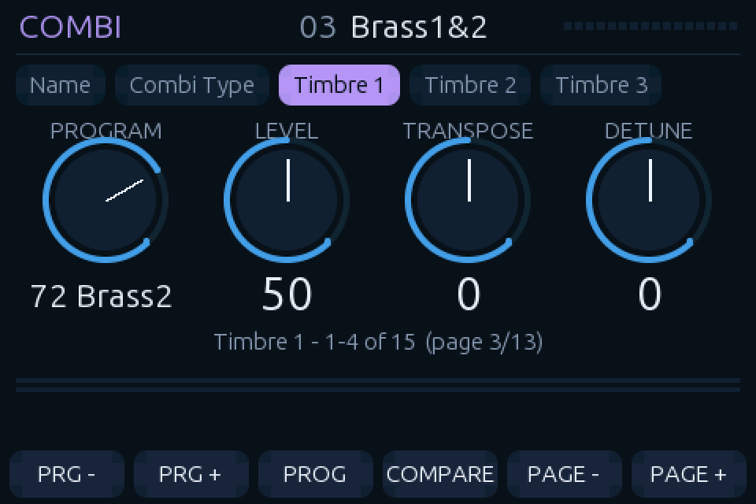
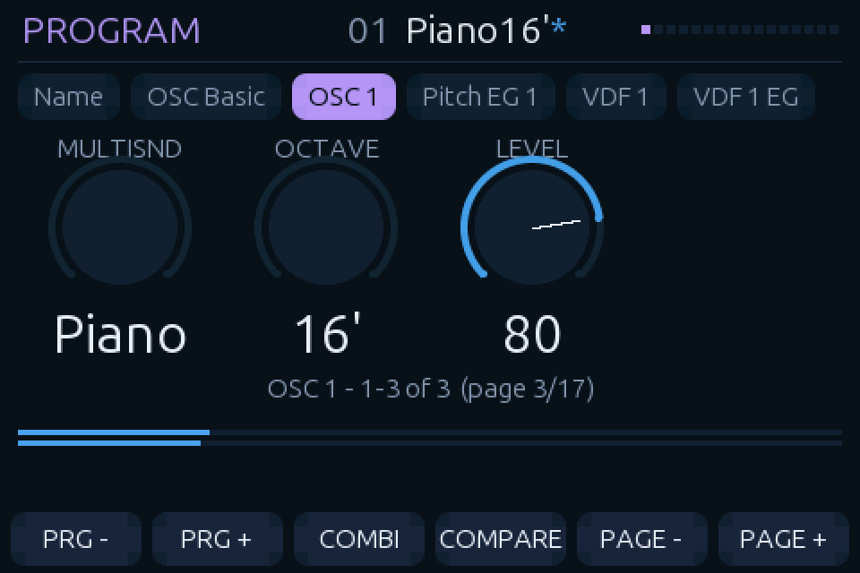
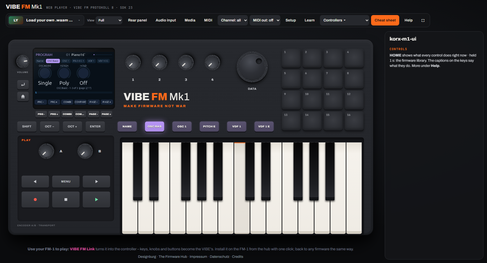

# KORX-M1 Hub UI

Experiments in running the **PicoFaceM1** Korg M1 engine ([Michi71's PicoVintageSynthCollection](https://github.com/Michi71/PicoVintageSynthCollection)) as a **WebAssembly firmware for the VIBE FM Firmware Hub**, with a native-looking 480×320 touch UI, and as a firmware for the **M-VAVE FM-1**.

> ## Status: early, unfinished, not yet listened to
> There is now a **ROM-free build you can download and load**: [release free-v0.1.0](https://github.com/fizzy2562/korx-m1-hub-ui/releases/tag/free-v0.1.0) (`korx-m1-free.wasm`, 163,560 bytes, sha256 `e76a0c31c33f8449091678ea8e1115ec9a9b347112c0cdef8c4806b0db371648`). It is **not a clone of the Korg M1** and does not sound like one. Everything about it has been checked by measurement and in a headless browser; nobody has judged it by ear yet. Treat this repository as a progress record and a code base to build on.

## Try it

1. Download `korx-m1-free.wasm` from the [release](https://github.com/fizzy2562/korx-m1-hub-ui/releases/tag/free-v0.1.0).
2. Open the [VIBE FM Firmware Hub](https://play.thefirmwarehub.com/), choose **Load your own .wasm**, and pick the file.
3. Play the on-screen keys, MIDI or the Hub's keys. Tap **HOME** for an on-screen help page that says what every control does right now; holding HOME for 1 s is the Hub's own library shortcut. Full list: [docs/CONTROLS.md](docs/CONTROLS.md).

## What the free build is

| | |
|---|---|
| Engine | PicoFaceM1 (Michi71, GPL-3.0), compiled from source |
| Sounds | 8 synthetic band-limited waveforms generated from maths (sine, saw, square, triangle, organ, narrow pulse, soft saw, noise). **No Korg audio went into them** |
| Programs | 19 original programs and 4 combinations, written as parameter values |
| Effects | All 33 effect types have tables of our own design (comb/all-pass reverbs, modulated delays, and so on) and are render-tested against a dry twin. They are designed to work, not to match the M1's effects |
| Tables | Pitch, filter, envelope, LFO, velocity and pan tables are formula-based models. A few constants follow documented behaviour of the real engine |
| UI | M1-style 480x320 LCD: pages, editing, key captions that change per page, help screen, all 33 effects selectable |
| Checks | Pitch within 0.85 cent over notes 36-108, 144 UI checks, 33/33 stress tests, 66 per-effect render checks |

**Known problems:** the timbre is static, sustain is flat, releases are short and bells are dull compared with the real thing (the tables are guesses, not measurements). Layout bugs: the help page's K-column is misaligned, E1-E4 read "Unused" on Program play, the effect-page status line is clipped against the soft keys, the first column's slider draws half a bar, and the Program line shows `Off` instead of a multisound name. Details: [docs/ROM_FREE_BUILD.md](docs/ROM_FREE_BUILD.md).

To build it yourself, see `build/build_free.bat` (add `-s` and `-ffile-prefix-map` for the small release build).

## What is in this repository

| Path | What |
|---|---|
| `src/ui/` | The UI: `gfx.h` (RGB565 drawing library: anti-aliased text, rounded rectangles, arcs), `m1ui_model.h` (pages, editing, program/combi stepping, button and encoder handling), `m1ui_view.h` (the screen), `font_data.h` (baked Ubuntu Medium, three sizes), `m1_params.{h,cpp}` (the M1 parameter tables, **from PicoFaceM1**, GPL-3.0) |
| `src/adapter/` | The Firmware Hub adapter (`hub_adapter_ui.cpp`): the Hub's `vibe_wasm_*` ABI around the Pico engine, 31.25 kHz → host-rate resampling, the soft limiter, the UI hooks. `hub_adapter_baseline.cpp` is the earlier UI-less version. `lite_sets_*.h` list which programs exist in each build |
| `tools/` | `shot.mjs` (render the wasm's screen to a PNG with scripted button/encoder events), `levels.mjs` (peak / clipping measurements), `bake_font.py` (font baker), `wasm_sig.mjs` / `wasm_imports.mjs` (ABI inspection), `lite-bank/` (the sample-compression and bank tools for the FM-1 build) |
| `build/` | The Windows `zig c++` build scripts used on the build box |
| `src/free/`, `tests/free/` | **ROM-free build**: generated tables, synthetic samples and original patches, so the engine runs with no Korg data (see [docs/ROM_FREE_BUILD.md](docs/ROM_FREE_BUILD.md)) |
| `docs/` | [STATUS](docs/STATUS.md) (where we are), [FINDINGS](docs/FINDINGS.md) (the technical discoveries: Hub ABI, control IDs, layout standard, bugs), [SOUND_ISSUES](docs/SOUND_ISSUES.md) (the open audio problem), [CLEAN_ROOM_SPEC](docs/CLEAN_ROOM_SPEC.md) (a behaviour-only specification of the M1 engine, for an independent implementation), [REA_PLAN](docs/REA_PLAN.md) (how to use REA to confirm and extend it), [THIRD_PARTY](docs/THIRD_PARTY.md), `images/`, and `qwen-briefs/` (the prompts the code was generated from) |

## What is deliberately NOT in this repository

Everything that contains or is derived from **Korg's ROM data** is left out, and `.gitignore` blocks it:

* the Korg-sample `.wasm` builds (they embed the 4 MiB sample ROM). The ROM-free `korx-m1-free.wasm` is published as a release,
* the FM-1 `.fwsc` firmware package and the compressed sample banks,
* the PCM / ROM images and the generated `m1_rom_tables.h`,
* the ROM archives themselves (`korgm1.zip`, `Korg M1 - Rev 19 Firmware.zip`, `M1_Sounds.zip`).

To build it you must supply **your own legally obtained M1 ROM set** and generate the tables with PicoFaceM1's `tools/m1_extract`. See [docs/STATUS.md](docs/STATUS.md#how-to-build).

## Screenshots

The old screen, then the new one rendered by the headless harness, then inside the real Firmware Hub:

| | |
|---|---|
|  |  |
| The target: a native VIBE firmware (OBERVAVE, GPL-3.0) | Program mode, OSC 1 page, edited program (`*`) |
|  |  |
| Combination mode, Timbre 1 page | A held note: voice dot and L/R meters |

## How it was made

The code was written by a local LLM (qwen3.8 27B, run on a build box) from short written briefs (see `docs/qwen-briefs/`); an AI orchestrator reviewed every diff and verified with renders and measurements. Changes were applied with small exact-match patch scripts rather than whole-file rewrites, because a whole-file rewrite of a large file truncated. No audio was ever listened to by the models, so **sound quality has only been measured, never heard, except by the human tester**.

## Licence

GPL-3.0-or-later, because `src/ui/m1_params.*` come from PicoFaceM1 (GPL-3.0-or-later). The baked font is under the Ubuntu Font Licence. See [docs/THIRD_PARTY.md](docs/THIRD_PARTY.md).
